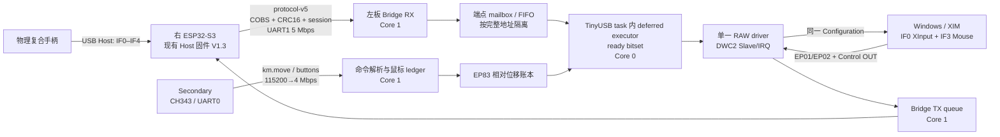

# MAKCM 左板原生 USB 复合代理实施方案

状态：实施基线草案  
日期：2026-08-01  
目标设备：`VID:PID 4131:3519`，IF0–IF4，EP81/01、EP82、EP83、EP84/02  
目标问题：Secondary 运行并持续注入鼠标时，手柄/XInput 不再出现数十至数百毫秒冻结

## 1. 结论与实施决策

这套 MAKCU 双 ESP32-S3 硬件可以实现“原手柄复合设备 + 独立鼠标接口”的同时转发。这里不是让 XInput 包承载鼠标，而是原样保留同一 USB Configuration 下的多个接口：IF0 的 XInput 走 EP81/01，IF3 的 HID Mouse 走 EP83。

本方案采用以下主线：

1. 保留双 ESP32-S3 和现有接线；右板继续做 USB Host，左板继续做 USB Device。
2. 冻结右板 V1.3 和 MCU 间 protocol-v5，不把多个变量同时改动。
3. 新建一个原生 ESP-IDF 左板工程，现有 Arduino V1.6 工程与二进制作为回滚基线保留。
4. 左板关闭 TinyUSB 内建 HID、Vendor、CDC class，由一个 RAW proxy driver 独占 IF0–IF4。
5. EP81、EP82、EP83、EP84、EP01、EP02 按完整端点地址各自拥有状态、缓冲、队列和完成归属。
6. 不设置“手柄硬优先”，也不在 EP81 与 EP83 之间做二选一仲裁；一次 executor 唤醒要把所有当前可提交端点都挂起。
7. 第一版使用 DWC2 Slave/IRQ；只有正确性全部通过后才做 DMA A/B 测试。
8. 发布验收必须在 `BRIDGE_MOUSE_MODE unlimited` 下通过；125/250/500/off 仅用于定位问题。

最终正确性定义是：

> EP81 和 EP83 可以同时处于 armed/InFlight；一个端点的 busy、完成、失败、NAK 或重试不改变另一个端点的状态和缓冲。

USB Full-Speed 总线上的事务仍然由主机串行调度，因此不要求 USBPcap 中严格出现 `81,83,81,83`，也不要求两个端点“同时完成”。

## 2. 对附件结论的精确修正

附件的总体方向正确，但实施时必须使用以下更精确的资源表述。

### 2.1 真正用满的是 IN，不应笼统说全部端点资源用满

ESP32-S3 有 EP0，以及端点号 1～6；设备模式最多同时启用 5 个 IN，其中包括 EP0 IN。目标配置为：

```text
EP0 IN/OUT  Control

0x81 IN     XInput
0x01 OUT    XInput
0x82 IN     Keyboard HID
0x83 IN     Mouse HID
0x84 IN     Vendor HID
0x02 OUT    Vendor HID
```

因此：

```text
并发 IN = EP0 IN + 81 + 82 + 83 + 84 = 5
```

这确实达到 IN/TX FIFO 数量硬上限，不能再增加 USB CDC、调试 HID 或任何其他 IN 端点。不过目标地址只使用端点号 1～4，不能把“6 个非控制方向地址”直接等同于“端点号 1～6 全部耗尽”。

| 资源 | ESP32-S3 / 新 DWC2 目标 | 本设备 | 结论 |
|---|---:|---:|---|
| 端点号 | EP0 + 1～6 | 使用 1～4 | 没有用到 5、6 |
| 同时启用的 IN | 最多 5，包含 EP0 IN | 5 | 硬上限，零新增 IN 余量 |
| OUT | 共用 RX FIFO | 01、02 | 可实现，需实测重挂 |
| DFIFO | 目标 DWC2 配置 256 × 32-bit word | FS 包长不超过 64 B | 预计有容量余量，必须打印实际分配 |
| 总线 | Full-Speed 12 Mbps | 数十 KB/s 量级 | 原始带宽不是瓶颈 |

### 2.2 FIFO RAM 不能靠估算宣布“刚好用满”

每个 IN 有独立 TX FIFO，所有 OUT 共用 RX FIFO。方案必须在启动时输出所锁 DWC2 的实际 RX/TX FIFO 分配、每个端点的 `wMaxPacketSize` 和剩余 word。只有 endpoint open 和 FIFO 分配实测成功，才算资源验证通过。

### 2.3 第一版不用 DMA 作为前提条件

目标报告为 7～64 B，吞吐远低于 Full-Speed 上限。DMA 不会修复 class driver 抢接口、共享 busy、错误缓冲生命周期或 EP0 阻塞。Slave/IRQ 先作为正确性基线；DMA 只能在同一描述符和同一状态机下单独 A/B。

### 2.4 RAW driver 必须复制控制面，而不只是六个数据方向

XInput 是否被 Windows 正确绑定，取决于整套 Device、Configuration、Interface、String、HID Report、控制请求响应和 STALL 行为。只复制 VID/PID 或 EP81 报告不构成完整代理。

## 3. 现状证据与当前风险

### 3.1 当前工具链

现有左板使用：

- PlatformIO `espressif32 6.7.0`
- Arduino-ESP32 `2.0.16`
- ESP-IDF `4.4.7`
- TinyUSB `0.16.0`

本地旧 DWC2 配置仍有 `DWC2_EP_MAX 6` 以及“ESP32Sx 只有 5 个 TX FIFO”的 TODO；TinyUSB 0.18 后修复了 DWC2 IN 计数和 endpoint count，0.20 又改变了首个 IN 包写 FIFO 的路径。因此升级值得做，但“升级版本”本身不是已经证明的根因。

### 3.2 当前代码已经做对的部分

下列逻辑应迁移或复用，而不是重新发明：

- [`common/BridgeProtocol.h`](../common/BridgeProtocol.h)：protocol-v5、COBS、CRC16、sequence、session。
- [`common/EndpointTxPhase.h`](../common/EndpointTxPhase.h)：`Closed/Idle/Starting/InFlight/Completing`。
- [`common/HidMouseReport.h`](../common/HidMouseReport.h)：HID report 解析、Report ID、相对字段合成。
- [`common/MouseInjectionLedger.h`](../common/MouseInjectionLedger.h)：提交快照、成功完成后退休、失败回滚。
- [`MAKCM_ESP32s3_Device_Mouse_Left/src/BridgeTransport.cpp`](../MAKCM_ESP32s3_Device_Mouse_Left/src/BridgeTransport.cpp)：profile/session/device-gone 生命周期。
- [`MAKCM_ESP32s3_Device_Mouse_Left/src/PassthroughDevice.cpp`](../MAKCM_ESP32s3_Device_Mouse_Left/src/PassthroughDevice.cpp)：原始描述符存储、XInput latest-wins、OUT 回调不直接等待 UART。

### 3.3 当前左板仍有的架构风险

1. [`include/tusb_config.h`](../MAKCM_ESP32s3_Device_Mouse_Left/include/tusb_config.h) 同时启用了 `CFG_TUD_HID=1` 和 `CFG_TUD_VENDOR=1`，又注册 RAW driver，存在多个 class driver 争夺接口的风险。
2. 同一文件把 `CFG_TUD_ENDPOINT0_SIZE` 拼成了 `CFG_TUD_ENDOINT0_SIZE`，自定义 EP0 配置可能未生效。
3. [`USBSetup.cpp`](../MAKCM_ESP32s3_Device_Mouse_Left/src/USBSetup.cpp) 一边返回原始描述符，一边仍经 Arduino `USB.begin()`/元数据 API 启动设备，存在双重所有权。
4. `PassthroughDevice::inputTask()` 固定按端点号 1→5 扫描，并在有工作时使用 1 ms 轮询；状态虽已部分独立，调度仍有统一扫描点。
5. `forwardControl()` 可在 TinyUSB control callback 路径中等待 UART 最多 120 ms。这会阻塞 USB device task，必须从新架构中去掉。
6. 现有任务使用 `xTaskCreate()`，没有明确核绑定；Arduino UART task、TinyUSB task和代理任务的抢占关系不可精确控制。

### 3.4 现有实测能排除什么，不能排除什么

- V1.6 将 Secondary UART0 RX 缓冲增至 4096，并改用 1 ms 任务轮询后，非法/破碎 `km.move` 基本消失，但用户仍能复现卡顿。
- `diagnostics/wire_trace_20260801_v16_stutter` 中 3204 条 `km.move` 可完整解析，说明“Secondary 命令已完整到达”仍不能证明 USB 端点没有停顿。
- 现有状态样本中 XInput 队列深度为 0、高水位为 1、drop 为 0，started/completed 最终相等；这排除了普通的应用 FIFO 长时间堆积，但不能排除先停顿后追平、DCD 调度饿死或 class driver/EP0 阻塞。
- 现有四份 wire trace 的 metadata 都是 `overflow=1`，只能做短窗口 CH343 串口取证，不能代替 10 分钟 USB 端点并行证明。

所以当前最合理的定位是：问题边界已经从“Secondary 串口是否损坏”收缩到左板 USB 栈所有权、DWC2 端点挂起/完成路径、EP0 阻塞或 Windows 侧轮询行为；还不能在没有最小样机的情况下宣布某一个为唯一根因。

## 4. 目标架构



架构边界：

- 右板负责真实设备、原始描述符、端点采样和物理 control/OUT。
- 左板负责 USB Device 身份、每端点挂起状态、EP83 注入、Secondary 命令和 PC 侧控制响应。
- USB callback 不做格式化日志、动态分配、阻塞 UART 或等待其他端点。
- 调试只走 CH343/UART 或 RAM 事件环，不增加 USB 接口。

## 5. 可复现工具链基线

新左板使用独立目录和原生 `idf.py` 工程。首个候选矩阵为：

| 组件 | 候选固定版本 | 原因 |
|---|---|---|
| ESP-IDF | `v5.5.5` 候选 | 当前 v5.5 bugfix 线；首版不引入 IDF 6 的额外迁移变量 |
| `espressif/esp_tinyusb` | `2.2.1` | 支持运行时描述符、任务参数和 CPU affinity |
| `espressif/tinyusb` | `0.21.0~1` 候选 | Espressif 维护的 Device fork，包含此前 DWC2 修复；必须由 resolver 与样机验证 |
| 访问模式 | DWC2 Slave/IRQ | 正确性基线 |

版本策略：

1. 先由 IDF Component Manager 实际解析并完成空工程构建；只有 registry revision、IDF 依赖和 API 全部兼容后，才把 exact 版本/commit 与 `dependencies.lock` 作为基线入库。不得仅凭文档中的候选号跳过 resolver 验证。
2. 固件启动状态中打印 IDF、esp_tinyusb、TinyUSB 版本/commit、Slave/DMA 模式。
3. 如果 0.21.0~1 无法通过六端点样机，只在独立分支选一个较早的已发布版本做对照；不同时修改状态机，并分别保留 lock file。
4. 不把上游 TinyUSB 文件直接覆盖进 Arduino Core。若必须补 DCD/EP0，使用最小 patch、固定 commit，并附上回归测试。
5. 关闭 Wi-Fi、BLE 和不使用的后台组件，减少 flash/cache 与调度噪声。
6. `usbd_app_driver_get_cb`、`usbd_defer_func`、`usbd_edpt_*`、DCD close-all/FIFO hook 都是版本耦合点；集中封装在 `tinyusb_adapter`，每次依赖变更先通过 adapter 编译测试和 P2，不允许散落在业务代码中。

首版 class 配置原则：

```text
CDC = 0
HID = 0
Vendor = 0
MSC/MIDI/DFU = 0
EP0 size = 64
一个应用 RAW class driver = 1
```

这里关闭的是 TinyUSB 内建 class 实现，不是从原始 Configuration Descriptor 删除 HID/Vendor 接口。

## 6. 描述符与 profile 自检

右板继续通过 protocol-v5 发送原始 Device、Configuration、HID Report 和 String descriptors。左板收齐并验证后才能拉起 D+；任何失败都保持 detached，禁止部分冒充。

### 6.1 必须验证的条件

- `bMaxPacketSize0 == 64`。
- 单一 Configuration，`bConfigurationValue == 1`。
- 只支持 alternate setting 0；出现运行时 alternate stream 直接拒绝。
- Full-Speed control/interrupt/bulk；不支持 isochronous。
- 每个 `wMaxPacketSize` 为 1～64 B。
- 非控制 IN 不超过 4；连同 EP0 IN 不超过 5。
- 最大端点号不超过所锁 DCD 的能力。
- 端点地址不重复；一个地址只归属一个接口。
- 每个接口实际 endpoint 数与 `bNumEndpoints` 一致。
- `wTotalLength`、接口数、HID report 总长度、字符串索引全部闭合。
- IF0/IF1/IF2/IF3/IF4 以及 EP81/01、EP82、EP83、EP84/02 与目标 golden profile 一致。
- IF3 HID report 能解析为有符号相对 X/Y；目标 Report ID 4、7 B 报告必须保持原样。
- BOS、Device Qualifier、字符串 `0xEE`、Microsoft OS descriptors：物理设备返回什么，代理就返回相同数据或相同 STALL。
- Configuration 的 Remote Wakeup 位与 direct control census 一致；若声明且主机实际使用，必须实现第 11 节链路，不能只复制 bit。

### 6.2 启动资源日志

```text
USB_STACK=idf-.../esp_tinyusb-.../tinyusb-<commit>
USB_MODE=slave
EP 81 IN  type=... mps=... interval=...
EP 01 OUT type=... mps=... interval=...
EP 82 IN  type=... mps=... interval=...
EP 83 IN  type=... mps=... interval=... report=4/7
EP 84 IN  type=... mps=... interval=...
EP 02 OUT type=... mps=... interval=...
DFIFO rx=<word> tx0=<word> tx1=<word> ... free=<word>
PROFILE_ACCEPTED session=<id> hash=<sha256>
```

资源日志通过 CH343 查询，不能常驻逐包打印。DFIFO 不是 esp_tinyusb 公共查询 API：P2 需要在锁定的 DWC2 commit 内加入最小只读诊断 hook/寄存器快照，或逐行镜像同版本 FIFO 分配公式并结合所有 open 结果核验；诊断 patch 的 commit/hash 必须进入版本清单。

## 7. 单一 RAW class driver

RAW driver 独占：

```text
IF0  FF/5D/01  XInput
IF1  FF/FD/13  Vendor control
IF2  HID        Keyboard
IF3  HID        Mouse
IF4  HID        Vendor HID
```

需要实现或接入以下入口：

- init/reset/open；
- interface/class/vendor control callback；
- endpoint transfer completion callback；
- set-configuration、bus reset、suspend、resume、disconnect 生命周期；
- endpoint halt/clear-feature 后的本地 phase 和物理端点同步；
- EP01、EP02 的持续重挂。

USB connect 前先做两遍 preflight：第一遍验证完整 descriptor、owner map、端点/IN 上限；第二遍按所锁 DWC2 的规则模拟 FIFO 和 open 能力。class driver 的 `open` 仍可能由 TinyUSB 按接口多次调用，因此运行时只累计 `opened_address_mask`，六个预期方向全部打开后才把代理标为 Configured。

如果任一接口/端点实际 open 失败，不承诺在该 callback 中“回滚前面五个接口”。应使本次配置失败，推进 epoch，并在 control transaction 退出后执行所锁版本已验证的 `disconnect + close_all/deinit + clean reinit`；不得留下部分可工作的复合身份。

## 8. 每端点状态机与缓冲所有权

### 8.1 端点上下文

端点按完整地址索引，不把 `0x81` 与 `0x01` 合成一个共享 busy：

```c
struct endpoint_ctx_t {
    uint8_t  address;
    uint16_t max_packet;
    uint8_t  interval;
    ep_phase_t phase;       // Closed/Idle/Starting/Armed/Completing/Halted
    uint32_t epoch;

    alignas(4) uint8_t compose[64];
    alignas(4) uint8_t inflight[64];
    uint16_t submitted_len;
    bool ready;

    endpoint_metrics_t metrics;
};
```

首版即使关闭 DMA，也保持静态、4 B 对齐、内部 SRAM 缓冲；DCD 使用中的 `inflight` 从 submit 到 completion 都不可改写，不使用栈上临时数组作为传输缓冲，也不把 PSRAM 指针直接交给 DCD。

### 8.2 通用状态转换

```text
Closed --open/configure--> Idle
Idle --ready--> Starting --submit ok--> Armed
Starting --submit fail--> Idle（pending 保留）
Armed --callback--> Completing
Completing --full success--> Idle（只结算本端点）
Completing --fail/short--> Idle（本端点回滚/重试）
任意状态 --reset/disconnect--> epoch++ / Resetting / Closed
```

硬性不变量：

1. 任一时刻每个地址最多一个 DCD transfer。
2. 完成回调必须用回调里的实际 endpoint address 查找上下文。
3. EP81 完成不得清 EP83 的 phase、ready 或 buffer；反向同理。
4. callback 只结算、置 ready bit 和通知 executor；不做全端点扫描和 UART 写入。
5. epoch 不匹配的 late callback 只计 `stale`，不能触碰新 session 数据。
6. `submitted_len == completed_len` 才是完整成功；EP83 提交 7 B、完成 7 B 是成功，即使 MPS 为 64。

### 8.3 Event-driven executor 与 TinyUSB 线程合同

使用一个原子 `ready_mask`，每一位代表一个完整端点地址的待处理事件。executor 被唤醒后取走快照，并尝试提交快照中所有可提交端点，而不是处理一个后返回：

```text
EP81 数据到达 -> set READY_81
EP83 数据/ledger 到达 -> set READY_83
EP02 OUT 完成 -> set REARM_02

executor wake:
  snapshot = exchange(ready_mask, 0)
  for each bit in snapshot:
      if this endpoint is Idle:
          prepare and submit this endpoint
      else:
          retain its own pending state
```

executor 不是另一个可以任意调用 TinyUSB private API 的 FreeRTOS task。首选合同是：

1. Core 1 producer 只更新 mailbox/ledger 和 `ready_mask`。
2. 从未排队变为有工作时，通过所锁版本的 `usbd_defer_func()` 或等价、经验证的 stack-event 入口，把一次 drain 派发到 TinyUSB device task。
3. 只有这个 TinyUSB task 上下文可以执行 endpoint submit；每次严格使用 `usbd_edpt_claim -> usbd_edpt_xfer -> usbd_edpt_release`，claim 只保护提交，不持有到完成。
4. completion callback 本身也在 stack 上下文，只结算本端点并再次置 ready；用一个原子 `executor_scheduled` 防止重复塞满 defer queue。
5. 若所锁版本没有安全的 defer 入口，则改用项目自管的 TinyUSB service task：该任务循环调用 `tud_task_ext()` 并在同一任务内 drain ready bits。禁止退化为 Core 1 UART task直接调用 `usbd_edpt_xfer()`。

`usbd_defer_func` 和 `usbd_edpt_*` 属于需要版本锁定的内部接口；应封装在一个 adapter 中，并把跨任务排队、reset 竞态和队列满作为 P2 的明确测试项。

在一次 drain 中可以先调用 `xfer(81)` 再调用 `xfer(83)`；二者随后同时保持 Armed，等待主机分别轮询。这不是“81 硬优先”。

## 9. 各端点的数据策略

| 端点 | 数据语义 | Pending 策略 | 完成策略 |
|---|---|---|---|
| EP81 IN | XInput 完整绝对状态 | 单槽 latest-wins；忙时覆盖未提交旧状态 | 成功后若 generation 已更新，立即挂最新状态 |
| EP82 IN | 键盘状态/按键边沿 | 有序、去除连续完全相同报告；不能粗暴 latest-wins | 按顺序退休；overflow 为测试失败 |
| EP83 IN | 物理相对鼠标 + 注入相对量 | 物理报告 FIFO + 注入 ledger + 按钮代际 | 只在完整成功后退休本次快照 |
| EP84 IN | Vendor HID，语义未知 | 默认有序 FIFO；只有抓包证明是绝对状态才可合并 | 按顺序退休 |
| EP01 OUT | XInput rumble/LED | 常驻 RX 双缓冲，完成后尽快重挂 | 数据异步送右板，不在 callback 等 UART |
| EP02 OUT | Vendor HID OUT | 与 EP01 完全独立 | 与 EP01 完全独立 |

队列深度不是正确性的替代品。建议 EP82/EP84/物理 EP83 从 16 项起步；稳态任何 drop 都判失败，而不是通过扩大 FIFO 隐藏调度空洞。

## 10. EP83 鼠标合成与守恒

### 10.1 相对位移不转绝对坐标

总不变量：

```text
已接受的相对整数总和
  = 已成功完成的相对整数总和 + 当前 pending 总和
```

每次提交必须保存本次 reservation：

```text
pending x = 100
本报告可发送 sent_x = 40
传输期间又收到 +20，pending 变为 120
完整成功后只减 sent_x，pending = 80
```

完成时不能清空当前 ledger，也不能重新读取当前值作为扣除量。

### 10.2 组成报告

1. 若有物理 EP83 报告，复制最旧未完成物理报告到 compose。
2. 校验 Report ID/长度；按 HID 描述符字段读取物理按钮和相对 X/Y/Wheel/Pan。
3. 将注入按钮 latch 与物理按钮做 OR。
4. 对每个相对字段按 logical min/max 独立 clamp；只 reserve 实际写入的量。
5. 固定保持目标 Report ID 4 和 7 B 长度。
6. 若没有物理报告但 ledger 有数据，使用最近有效报告作为模板，归零物理相对字段后生成独立 EP83 报告。
7. 完整成功才退休物理 active report 与注入 reservation；失败/短完成则两者都留待 EP83 重试。

### 10.3 reset 与 session 语义

- PC 侧 bus reset：回滚 active reservation，重开/重挂端点；同一物理 session 的按钮 latch 与尚未完成的相对量保留并标 dirty。
- 物理设备 `DeviceGone` 或 bridge session 改变：清空所有物理 FIFO、ledger 和注入按钮，防止旧设备输入进入新 session。
- STALL/CLEAR_FEATURE：只恢复对应端点；若 EP83 active 未成功，先回滚 reservation。

## 11. EP0 与控制请求方案

这是迁移中除端点并发外的第二个高风险项。新架构禁止在 TinyUSB task 中同步等待 UART 120 ms。

### 11.1 先建立 golden control census

用 USBPcap 抓物理手柄直接连接 Windows 的完整过程：

1. 冷插入到设备管理器/XInput ready；
2. 启动使用该手柄的程序；
3. 触发 rumble、LED、Feature GET/SET；
4. suspend/resume；
5. 拔插与重新枚举。

把每个请求整理为：

```text
阶段
bmRequestType / bRequest / wValue / wIndex / wLength
recipient = device/interface/endpoint
响应 = DATA / ZLP / STALL
响应长度
内容是否恒定、是否随运行状态变化
```

### 11.2 控制请求分类

| 类型 | 左板处理 |
|---|---|
| Device/Configuration/String/HID Report Descriptor | 本地 raw store 立即回答 |
| SET_ADDRESS/SET_CONFIGURATION、标准 EP 状态 | TinyUSB core；RAW driver 同步本地 epoch/phase |
| HID GET/SET_REPORT、GET/SET_IDLE、GET/SET_PROTOCOL | 按 golden 行为本地回答或代理；每接口维护独立状态 |
| 标准 GET_INTERFACE/SET_INTERFACE | 目标只支持 alt 0：GET 返回 0，SET 0 按 golden 成功，其他值按 golden STALL |
| Device GET_STATUS、SET/CLEAR_FEATURE(REMOTE_WAKEUP) | 本地维护主机授权位，并与 suspend/resume/唤醒链路联动 |
| Endpoint GET_STATUS、SET/CLEAR_FEATURE(HALT) | TinyUSB core 处理总线动作；通过公开事件或最小 hook 同步指定完整地址的 phase、toggle 和 rearm |
| 枚举期恒定 vendor/class IN | 在 PC attach 前缓存，立即回答 |
| 运行时可变 IN | deferred EP0 broker；右板回包后继续 data/status stage |
| OUT/无数据 vendor/class | 转发右板，并按物理设备的 ACK/STALL 行为完成 status stage |
| 未知请求 | 与 golden 设备一致地 STALL 或成功，不能默认全部 ACK |

### 11.3 Deferred EP0 决策门

在移植完整控制逻辑前，单独做一个 prototype：SETUP 到来后保持 EP0、异步等待任务消息，再从 TinyUSB task 上下文恢复 DATA/STATUS；同时 EP81/EP83 不能停。

按以下顺序选择：

1. 所锁 TinyUSB/esp_tinyusb 的安全公开路径；
2. 若没有，尽量把 direct capture 证明恒定的响应预缓存；
3. 对确实动态且必需的请求，做最小、固定版本的 deferred-EP0 patch；
4. 如果需要右板预推控制缓存而 protocol-v5 无法表达，再单独设计 protocol-v6，不能与首轮 USB 迁移混在一起。

Deferred prototype 必须同时覆盖两条路径：动态 IN 的延迟 DATA/STATUS，以及带 OUT DATA 的请求在收齐 payload 后延迟 STATUS。Control OUT 不能仅凭“已放进 UART 队列”就无条件向 PC ACK；如果物理设备可能 STALL，最终版本必须等 downstream 结果或按经抓包证明的确定行为回答。每个 deferred transaction 都有 request id、session/epoch 和 golden 导出的超时；超时必须终止当前 broker 状态并按目标行为 STALL/复位，绝不遗留占用 EP0 的旧请求。

还要审计 TinyUSB core 对 `SET/CLEAR_FEATURE(ENDPOINT_HALT)` 的消费路径。如果 RAW driver 看不到该标准请求，就在所锁版本增加最小 endpoint-state hook，或使用公开、经验证的等价事件；该 hook 必须把 halt/clear、data toggle、OUT rearm 和本地 phase 同步到指定完整地址。不能只在文档里假定 core 会通知 RAW driver。

### 11.4 Remote Wakeup 决策

先由 golden Configuration 和 USBPcap 确认目标是否声明、Windows 是否授权并实际使用 Remote Wakeup：

- 若未声明或 direct capture 证明不使用，把“不支持 Remote Wakeup”写进 profile 边界并保持相同 STALL/位行为。
- 若声明并使用，则实现 `PC SET_FEATURE(REMOTE_WAKEUP) -> 左板保存授权 -> suspend 后右板/物理报告出现经 golden 定义的唤醒边沿 -> 左板在授权有效时调用 tud_remote_wakeup()`；CLEAR_FEATURE、bus reset、detach 必须清授权状态。
- 对错误时机、未授权调用和重复唤醒做单测与 USBPcap 对照。

## 12. 任务、双核与实时边界

建议初始分配如下；具体数字通过 ready→submit 延迟调整，不把优先级数字本身当验收结果。

| 任务 | Core | 初始优先级 | 栈 | 职责 |
|---|---:|---:|---:|---|
| TinyUSB device task + deferred executor | 0 | 20 | 6144 B 起 | DCD、EP0、class/完成 callback、ready drain、IN submit、OUT rearm |
| UART1 bridge RX | 1 | 18 | 4096 B | 5 Mbps COBS/CRC/session 解码 |
| Secondary UART0 RX | 1 | 17 | 4096 B | 4 Mbps `km.*` 解析、写 ledger |
| Bridge TX | 1 | 15 | 3072 B | EP01/02、control 发往右板 |
| Input monitor | 1 | 8 | 2304 B | 8 ms button stream、80/100 ms timeout |
| Metrics/LED | 1 | 4 | 2048 B | 状态快照、低频输出 |

约束：

- ISR/callback 只复制固定长度数据、更新时间戳、置位并 notify。
- 不在实时路径 `printf`、分配 heap、等待 mutex/UART 或做 JSON。
- UART1 使用原生 IDF UART event/ring buffer；RX 建议 8 KiB 起步，UART0 4 KiB 起步，并记录硬件/软件 overflow。
- 所有跨核共享字段使用原子变量、临界区或单生产者/单消费者队列；不依赖 `volatile` 代替同步。
- active endpoint buffers 放内部 SRAM；DMA 阶段再切到明确的 DMA-capable/cache-line 规则。
- 每个任务发布 stack high-water；候选版最小余量至少 512 B。

## 13. MCU 间 bridge 与 Secondary 合同

### 13.1 初期保持 protocol-v5 wire-compatible

迁移阶段不改：

- `kProtocolVersion = 5`；
- MessageType 数值；
- COBS、CRC16、sequence、session；
- ProfileBegin/ProfileReady/ProfileAccepted/StreamStarted；
- DeviceGone/DeviceGoneAccepted；
- EndpointIn/EndpointOut；
- ControlRequest/ControlResponse。

右板继续作为 V1.3 基线。只有新左板在纯物理透明转发阶段通过后，且证据明确需要新的控制缓存消息，才另立 protocol-v6 配对固件。

### 13.2 保持 Secondary 外部合同

- 初始 UART0 115200；
- `DE AD 05 00 A5 00 09 3D 00` 提速握手；
- 重开 4,000,000 baud；
- `km.version()`、`km.echo(0)`、`km.buttons(...)`、`km.move(...)` 和鼠标按钮命令；
- button wire frame 为 `"km." + mask + "\r\n>>> "`；
- 8 ms nominal button stream；停止状态流 80 ms 后 Secondary fail closed；控制器报告 100 ms timeout。

`MouseInjectionRateGate` 保留为诊断组件，发布默认 unlimited，不能成为 EP81 不冻结所依赖的保护机制。

## 14. 观测设计

热路径只累加计数器和直方图，不逐包打印。

### 14.1 每个 IN 地址记录

- `source_rx`、`bridge_tx`、`bridge_rx`；
- `ready`、`submit_ok`、`submit_fail`；
- `complete_ok`、`complete_fail`、`short`；
- `queue_drop`、`coalesced`；
- `last_source_us`、`last_ready_us`、`last_submit_us`、`last_complete_us`；
- source/submit/complete 最大间隔；
- ready→submit、submit→complete 直方图：`≤1/2/4/8/16/32/64/128/256/>256 ms`。

EP81 额外记录 latest-wins 覆盖次数；覆盖不是错误，但右板源持续时不允许完成端出现异常空洞。

EP83 额外记录 accepted/reserved/retired 各轴总和、pending 高水位、最老未退休 generation 年龄、reservation 持续时间。每次 accepted batch 都带单调 generation 和本地时间戳；reservation 保存截止 generation，完整成功后推进 retired watermark。`pending age` 定义为“当前最老未退休 generation 的时间戳到现在”，禁止用“ledger 自从何时非零”代替，否则连续 1000 Hz 流会必然误报。

全局记录：

- bridge RX frame/CRC/sequence/session error；
- USB reset/suspend/resume/detach；
- 当前 armed IN bitmap、`max_concurrent_armed` 和 `armed_81_83_overlap`；
- heap 最小值、每任务 stack high-water、watchdog/assert/reset reason；
- endpoint owner map 和 FIFO 分配。

指标分属三个时钟域，不能在左板内假装已经统一：

- 右板记录 `source_rx/bridge_tx`；
- 左板记录 `bridge_rx/ready/submit/complete`，并把 EndpointIn 的 bridge sequence 保留到 mailbox 和事件环；
- PC 端从 USBPcap 计算实际 bus transaction/complete 时间。

自动冻结只使用同一板上的本地条件；“右板 source 是否同时正常”和 PC 是否看到同一空洞在事后按 sequence、session 和捕获窗口对齐。如果未来需要左板实时知道右板 source，必须增加明确的诊断消息，不能凭推断。

### 14.2 自动冻结事件环

保留一个只记元数据的循环事件环：

```text
timestamp, session, epoch, endpoint, event, phase,
length, queue_depth, ready_age, pending_age, armed_bitmap
```

出现以下任一条件时冻结触发前窗口，并继续短暂记录触发后窗口：

- 左板 EP81 `bridge_rx` 仍在正常推进，但本地 EP81 complete gap > 10 ms；
- EP83 最老未退休 generation age > 20 ms；
- `submit_fail/complete_fail/short/drop/protocol_error` 任一增加；
- 意外 USB reset、session/epoch 改变；
- watchdog 或断言。

CH343 原始线继续用 [`capture_wire_trace.py`](../MAKCM_ESP32s3_Device_Mouse_Left/scripts/capture_wire_trace.py)；PC 侧用 USBPcap。二者分别观察 UART0 和 USB 总线，不能互相替代。

## 15. 分阶段实施与退出门

### P0：冻结回滚基线和 golden 证据

产物：

- 保留左板 [`Left_MAKCM_MCU_MCU_V1_6_SERIAL_RX.bin`](../MAKCM_ESP32s3_Device_Mouse_Left/merged_firmware/Left_MAKCM_MCU_MCU_V1_6_SERIAL_RX.bin)，SHA-256：`73047DAF40DBE1715D5C1E3D3F942AA02E5B6FCCFE90CB1D24F4FEFE55242C90`。
- 保留右板 [`Right_MAKCM_MCU_MCU_V1_3.bin`](../MAKCM_ESP32s3_HID_Mouse_Right/merged_firmware/Right_MAKCM_MCU_MCU_V1_3.bin)，SHA-256：`604A6967276D24464C9DBCD8C645AC954C6C9F97F01EEFE01711425241ED37B4`。
- 保存直连与 V1.6 代理的描述符、完整 USBPcap control census、`BRIDGE_STATUS`、`DEBUG_STATUS`、Windows USB 口/电源配置。
- 写下可重复的实际卡顿操作序列。
- 在任何新分区表、整片擦除或烧录前，先读取每块板的 flash ID/实际容量，再备份完整检测容量（当前公开设计预期 4 MiB）；至少单独留存 partition table、NVS、otadata 和其他状态分区。
- 保存 `espefuse summary`，迁移期间禁止新增 eFuse 写入；记录 esptool/AIO Tool 版本、端口、晶振/flash 参数、精确 offset 与 BOOT 操作。
- 实际执行一次“备份 → 新测试写入 → 恢复旧完整 flash/固件 → 验证现状”的演练。merged bin 的 hash 只能证明 bootloader/partition/app 文件，不能单独恢复 NVS、otadata 或 coredump 状态。

退出门：两块旧固件和状态分区可重新刷回并恢复当前状态；golden capture 能重放分析；恢复演练已通过。

### P1：原生 IDF 骨架，USB 保持 detached

产物：

- 新目录可用 `idf.py build/flash`；
- UART1 GPIO1/2、5 Mbps，连续解析 protocol-v5；
- UART0 完成 Secondary 提速握手和命令解析；
- profile raw bytes 收集和 SHA-256；
- USB 尚不 connect。
- 一个 protocol-v5 最大速率确定性 frame generator；在没有 `ProfileAccepted`/EndpointIn 实流时，它负责覆盖 5 Mbps 解码、CRC、sequence 回绕和队列压力。

退出门：右板 profile 生命周期正常；确定性 generator 在目标帧尺寸/速率下连续 10 分钟，bridge CRC/frame/session error、非预期丢号/倒序/重复和 UART overflow 均为 0。16-bit sequence 按模 65536 正常回绕必须通过。

### P2：人工六方向 DWC2 冒烟固件

此阶段不接右板、不接 Secondary，使用固定测试描述符和确定性数据，并配套一个可控 USB Host harness，先把硬件/DCD 与代理业务分离。测试描述符应保留目标地址、方向、类型、MPS 和 interval，但使用明确可绑定用户态驱动的测试身份；优先在 Linux/libusb 上 detach kernel driver 并对 81/82/83/84 同时保持异步读、对 01/02 同时循环写，Windows WinUSB/libusb 或专用 Host MCU 作为第二实现。harness 验证 endpoint 内 sequence、跨端点独立进度和最大空洞。没有 host 持续轮询，不能声称四个 IN 都已受压。

产物：

- 单一 RAW driver 打开四 IN、两 OUT；
- 各端点独立上下文和 ready mask；
- EP81、EP83 可同时 Armed；
- EP01、EP02 可同时持续重挂；
- reset、STALL/CLEAR_FEATURE、短/失败完成注入测试。
- 可重复运行的 WinUSB/libusb host harness 与原始结果文件。
- DCD shim/编译期开关，用于可重复注入 submit fail、failed completion、short completion 和 reset 竞态；不能依赖实机偶然制造这些错误。
- 锁定 DWC2 的 FIFO 诊断 hook/寄存器快照，或经测试的同版本分配公式镜像。

退出门：

- 连续枚举 100 次成功；
- 30 分钟四 IN + 两 OUT 压力无 submit_fail、complete_fail、short 或 drop；
- `max_concurrent_armed >= 2`，且构造负载下观察到 81/83 overlap；
- 任一端点故意 NAK/暂停不阻塞其他端点；
- FIFO 启动账可解释。

报告中必须区分“设备尚未 armed 导致 Host IN 得到 NAK”和“Host harness 主动暂停轮询”；两者不是同一种失败。

P2 失败时不进入原始描述符阶段；候选范围包括测试 descriptor、host harness、RAW driver/thread contract、TinyUSB/DWC2、FIFO、PHY 和板级信号。只有排除前三类软件因素后，才把边界收缩到 DWC2/PHY/FIFO。

### P3：原始描述符、RAW ownership 和控制面

产物：

- protocol-v5 raw profile validator；
- Device/Configuration/HID Report/String/BOS/OS 行为与 golden 一致；
- IF0–IF4 只由 RAW driver 打开；
- HID idle/protocol/report 与 vendor/XInput control census 完成；
- deferred EP0 prototype 通过，或对所有必需控制请求有经验证的本地缓存方案。

退出门：

- Windows Device Manager 的 Hardware IDs、selected driver、XInput 枚举与直连相同；
- 描述符逐字节一致；
- control 请求的 DATA/ZLP/STALL、长度和关键内容与直连一致；
- 连续 100 次冷枚举无失败；
- 枚举/控制操作期间无 EP81/83 非预期停止。

### P4：只做物理透明转发，Secondary 关闭

产物：

- EP81 latest-wins；
- EP82/EP84 ordered FIFO；
- 物理 EP83 FIFO；
- EP01/EP02/control 双向转发；
- protocol session + USB epoch；
- 完整 metrics/事件环。

退出门：

- XInput、键盘、物理鼠标、Vendor HID 同时工作；
- rumble/LED 正常；
- 30 分钟无 drop/error/short/stale/outdrop/ctrlerr；
- 物理 1000 Hz EP83 负载下，EP81 仍满足时延门；
- 50 次物理设备拔插无跨 session 输入。

### P5：接回 Secondary 与 EP83 注入

产物：

- `km.move`、按钮 latch、wheel/pan 写入 EP83 ledger；
- physical + injected 合成；
- reservation 成功退休/失败回滚；
- unlimited、125/250/500/off 诊断模式；
- 8 ms button stream 和超时逻辑。

退出门：

- 1000 Hz 注入 + 1000 Hz 物理鼠标 + 持续摇杆/扳机下，EP81 无 ≥20 ms 上游空洞；
- 所有相对位移精确守恒并能排空；
- unlimited 下通过核心并行测试；
- 限速不是通过所需条件。
- 同时满足第 16.2 节的 EP81 P99.9、EP81 max、ready→submit、EP83 generation age/排空以及 ≥20 ms 硬失败门，不能只检查“没有一次超过 20 ms”。

### P6：Slave 发布候选与恢复测试

产物：

- 10 分钟、1 小时、2 小时压力记录；
- USBPcap、左板 metrics、右板 metrics、CH343 短窗口 trace 可对齐；
- reset/suspend/resume、Secondary 重启、20～50 次热插拔；
- merged bin、版本清单、AIO Tool 回滚入口。

退出门：第 16 节全部量化指标通过，旧 V1.6 仍可刷回。

2 小时 soak 依靠累计 metrics 和触发事件环，不要求现有 128 KiB CH343 trace 保存全程；原始 CH343 只保留故障前后短窗口，USBPcap 使用端点过滤或滚动文件，避免全量捕获失控。

### P7：可选 DMA A/B

只在 P6 的 Slave 固件已通过后进行。启用 Buffer DMA 时：

- 使用所锁版本推荐的 endpoint buffer 宏或 DMA-capable allocator；
- 缓冲满足 cache-line 对齐和占用长度要求；
- reset/disconnect 清理 DMA 与 active reservation；
- 描述符、业务状态机和负载完全不变。

只有 CPU 占用或 P99/P99.9 时延有明确改善，且 30～60 分钟无新增错误时才保留 DMA；否则 Slave 就是生产模式。

## 16. 测试矩阵与量化验收

### 16.1 测试矩阵

| 编号 | 连接 | Secondary | 鼠标负载 | 手柄负载 | 目的 |
|---|---|---|---|---|---|
| T0 | 物理设备直连 PC | 关闭 | 无 | 连续操作 | Windows/手柄基线 |
| T1 | 新候选 MAKCM | 关闭 | 物理静止 | 连续操作 | 候选代理基线；V1.6 仅作历史对照 |
| T2 | MAKCM | 启动但不注入 | 无 | 连续操作 | 排除仅 CH343 连接影响 |
| T3 | MAKCM | 1000 Hz 注入 | 无物理移动 | 静止 | 单独 EP83 注入 |
| T4 | MAKCM | 关闭 | 1000 Hz 物理鼠标 | 连续摇杆/扳机 | 物理 83 + 81 |
| T5 | MAKCM | 1000 Hz 注入 | 物理静止 | R2、L2、同时按住、摇杆 | 核心并行门 |
| T6 | MAKCM | 1000 Hz 注入 | 1000 Hz 物理移动 | 连续摇杆 + rumble/LED | 最坏双向负载 |
| T7 | MAKCM | 实际 Secondary | 实际复现场景 | 实际复现场景 | 用户体验门 |
| T8 | MAKCM | 开启 | 混合 | 混合 | 热插拔、重连、挂起恢复 |

T3–T6 使用 CH343 合同兼容的确定性发生器，记录发送 sequence、时间戳、命令数和逐轴精确总和；T7 才使用真正 Secondary。物理 1000 Hz EP83 也必须使用可重复的测试鼠标/Host 注入或记录其实际 source 序列，不能只写“手动快速移动”。

执行时间：

- T0–T4：每项 60 秒快速门；
- T5、T6：每项 10 分钟；
- T7：至少 3 次，每次 10 分钟；
- T8：至少 20 次完整循环；
- 发布候选：2 小时混合 soak。
- 发布统计时 T0、T1 在相同 EP81 操作负载下各重新运行至少 10 分钟；60 秒结果只作 smoke，不用短样本的 max 与 10 分钟压力 max 比较。

### 16.2 初始通过门槛

先在同一 PC、同一 USB 口和同一电源设置下取得 T0/T1。若直连本身出现 ≥20 ms 异常空洞，先修测试环境。

| 指标 | 通过门槛 |
|---|---|
| EP81 complete interval P99.9 | `≤ max(4 ms, T1 P99.9 + 2 ms)` |
| EP81 complete interval max | `≤ max(10 ms, 2 × T1 max)` |
| 事后跨日志对齐确认右板 EP81 source 正常时的左板/PC 空洞 | 不允许 `≥20 ms` |
| EP81 ready→submit | P99.9 ≤ 2 ms，max ≤ 5 ms |
| EP83 普通小位移最老未退休 generation age | P99.9 ≤ 8 ms，max ≤ 20 ms；不得用 ledger 连续非零时长 |
| EP83 排空 | 停止产生后回到 `0/0/0/0`；大向量按分包数 + 20 ms |
| 固定 session 稳态 T1–T7 错误增量 | 左板 drop/error/short/stale/outdrop/ctrlerr = 0；比较前后增量，不看历史绝对值 |
| 右板错误增量 | txerr/overwrite/rxerr/cleanerr = 0 |
| UART | HW/SW overflow、CRC/frame decode error、sequence 非预期丢号/倒序/重复、非法 `km.move` = 0；允许 uint16 模 65536 正常回绕 |
| IN InFlight 差值 | 对每个 IN 地址和当前 epoch，`submit_ok - completion_callback_count ∈ {0,1}`；四 IN 合计可为 0..4；停止 IN producer 并排空后各自为 0 |
| 鼠标守恒 | `accepted_axis_sum = retired_axis_sum + pending_axis_sum`，逐轴精确相等 |
| 热插拔 T8 | epoch/session 推进，无旧 session 输入；允许与切换对应的 rejected-stale 增量，OUT 不套用 IN 排空规则 |
| 稳定性 | 无 panic/watchdog/reset，栈余量 ≥512 B，无持续 heap 下降 |

P99.9 不能从 `≤1/2/4/8 ms` 的粗桶反推出精确的 `基线 + 2 ms`。PC 侧 EP81 complete P99.9/max 由 USBPcap 原始时间戳离线计算；固件 ready→submit 使用微秒级桶或原始触发事件计算；右板 source 统计只在右板时钟域解释。每份结果必须注明数据源和时钟域。

### 16.3 必须运行的主机单测

现有五个测试全部纳入 ASan/UBSan：

- [`test_bridge_protocol.cpp`](../tests/test_bridge_protocol.cpp)
- [`test_endpoint_tx_phase.cpp`](../tests/test_endpoint_tx_phase.cpp)
- [`test_hid_mouse_report.cpp`](../tests/test_hid_mouse_report.cpp)
- [`test_mouse_injection_ledger.cpp`](../tests/test_mouse_injection_ledger.cpp)
- [`test_mouse_injection_rate_gate.cpp`](../tests/test_mouse_injection_rate_gate.cpp)

新增：

- EP81/EP83 随机交错属性测试；
- 六地址 reset/STALL/failed/short completion；
- ready bitset 公平性与一次唤醒全部提交；
- control request golden replay；
- session/epoch fuzz；
- descriptor/FIFO validator 边界输入。

### 16.4 不能作为成功证据的现象

- 81/83 在 USBPcap 中严格交替；
- `xx started == completed`、`mx started == completed` 最终相等；
- `xq/mq depth == 0`；
- `xc == 0`；XInput latest-wins 的覆盖是预期行为；
- 把 EP83 7/7 B 完成误报为相对 64 B MPS 的 short；
- XInput API 调用很快；它可能只返回缓存状态；
- 8 ms `km.buttons` 正常；它只证明 CH343 侧带链路；
- 主观“手感正常”而没有时间指标；
- 125/250/500 Hz 通过但 unlimited 失败。

## 17. 失败定位树与换硬件边界

```text
A. 无 UART、无 Secondary 的固定六方向测试固件
   ├─ 失败 -> DWC2 / FIFO / PHY / TinyUSB 栈层
   └─ 通过
       ↓
B. 原始描述符 + 本地控制缓存
   ├─ 枚举失败 -> 描述符 / class ownership / control 行为
   └─ 通过
       ↓
C. 加入右板 protocol-v5，但禁用 km.move
   ├─ 失败 -> UART / session / bridge / OUT-control 路径
   └─ 通过
       ↓
D. 启用 EP83 注入
   ├─ 失败 -> mouse ledger / report compose / endpoint executor
   └─ 通过 -> 方案成立
```

只有同时满足以下条件，才考虑更换左侧 Device MCU：

1. 新锁定栈下 Slave 和 DMA 都失败；
2. 无 UART、无 Secondary 的最小固件仍稳定复现；
3. DCD/FIFO/armed trace 能把失败定位到 S3 USB 控制器能力，而不是 class、buffer 或 EP0；
4. 至少两块 MAKCU 板复现，排除单板/线材/供电；
5. 同一描述符在具有更多独立 IN endpoint/FIFO 的候选 Device MCU 上通过。

替换 MCU 时只替换左侧 Device 角色，候选必须至少满足：四个非控制 IN、两个 OUT、原生 Full-Speed Device、≥5 Mbps UART、3.3 V IO、可精确自定义描述符和控制请求。达到上述证据前，不判定 ESP32-S3 硬件不适合。

## 18. 新工程目录与代码归属

建议并行新建，避免覆盖现有 Arduino 回滚目标：

```text
MAKCM_ESP32s3_Device_Mouse_Left_IDF/
├─ CMakeLists.txt
├─ sdkconfig.defaults
├─ partitions.csv
├─ dependencies.lock
├─ main/
│  ├─ CMakeLists.txt
│  └─ app_main.cpp
└─ components/
   ├─ makcm_common/
   │  └─ CMakeLists.txt
   ├─ bridge/
   │  ├─ include/bridge_transport.h
   │  ├─ bridge_transport.cpp
   │  ├─ bridge_profile_rx.cpp
   │  └─ bridge_tx.cpp
   ├─ usb_proxy/
   │  ├─ include/raw_proxy.h
   │  ├─ include/endpoint_context.h
   │  ├─ descriptor_store.cpp
   │  ├─ profile_validator.cpp
   │  ├─ descriptor_callbacks.cpp
   │  ├─ raw_class_driver.cpp
   │  ├─ endpoint_executor.cpp
   │  ├─ endpoint_in.cpp
   │  ├─ endpoint_out.cpp
   │  └─ control_proxy.cpp
   ├─ mouse_injector/
   │  ├─ include/mouse_injector.h
   │  └─ mouse_injector.cpp
   ├─ secondary/
   │  ├─ secondary_uart.cpp
   │  ├─ command_parser.cpp
   │  └─ input_monitor.cpp
   └─ diagnostics/
      ├─ status_counters.cpp
      └─ event_trace.cpp
```

`makcm_common` 直接引用仓库根 `common/`，不复制协议头，保证左右板只有一份 wire definition。legacy JSON 描述符代码和 `DseHidDevice.cpp` 不进入新目标。

## 19. 推荐的首轮工作包

不要一开始就把完整代理一次性移植。首轮只交付以下四件事：

1. P0 golden bundle：直连 USBPcap、描述符、control census、当前二进制哈希和复现步骤。
2. 原生 IDF 空壳：固定依赖、UART0/1、protocol-v5、USB detached。
3. P2 六方向冒烟固件：固定描述符、四 IN/两 OUT、ready bitset、armed overlap、FIFO 日志。
4. 自动 metrics：每端点间隔直方图和冻结事件环。

这四项完成后会得到第一个关键决策：

- P2 通过：硬件与 DWC2 基础能力成立，继续做原始身份和控制面。
- P2 失败：先在最小固件内定位，不再反复录制完整 Secondary 卡顿。

## 20. 完成定义

方案只有在以下条件同时成立时才算完成：

- Windows/XIM 看到与目标设备相同的复合身份、接口、驱动和控制行为；
- EP81 与 EP83 可同时 armed，完成互不干扰；
- 物理鼠标与注入鼠标的相对量精确守恒；
- 1000 Hz 注入和最坏双向负载下，EP81 不出现 ≥20 ms 异常空洞；
- 同时满足 EP81 complete P99.9/max、ready→submit 和 EP83 generation age/排空门，不能用“没有 ≥20 ms”掩盖频繁的 10～19 ms 小停顿；
- unlimited 模式通过，不依赖手柄硬优先或限速；
- reset、suspend/resume、热插拔、Secondary 重启不产生旧 session 输入；
- 2 小时 soak 无错误、重置或资源下降；
- 旧 V1.6 左板和 V1.3 右板仍有可验证的回滚二进制。

## 21. 官方参考

- [ESP32-S3 Datasheet：USB Device 端点与 IN 上限](https://documentation.espressif.com/esp32-s3_datasheet_en.pdf)
- [ESP-IDF v5.5 USB Device Stack](https://docs.espressif.com/projects/esp-idf/en/v5.5/esp32s3/api-reference/peripherals/usb_device.html)
- [ESP-IDF Releases](https://github.com/espressif/esp-idf/releases)
- [esp_tinyusb 2.2.1](https://components.espressif.com/components/espressif/esp_tinyusb/versions/2.2.1/readme?language=en)
- [Espressif TinyUSB Device fork 0.21.0~1](https://components.espressif.com/components/espressif/tinyusb/versions/0.21.0~1/readme)
- [TinyUSB Releases：DWC2 0.18/0.20 变更](https://github.com/hathach/tinyusb/releases)
- [TinyUSB ESP32 DWC2 配置](https://github.com/hathach/tinyusb/blob/master/src/portable/synopsys/dwc2/dwc2_esp32.h)
